# Аудит паролей с помощью менеджера паролей Bitwarden

Учебный проект по дисциплине «Информационная безопасность», работа 5.

**Публичный git-репозиторий:** https://github.com/semchik200001/password-manager-audit

Цель работы: осознать важность надёжных уникальных паролей и освоить менеджер
паролей. В ходе работы установлен Bitwarden, создана учётная запись с надёжным
мастер-паролем, проведён аудит паролей личных аккаунтов (в том числе проверка
почты по базе утечек Have I Been Pwned), для 5 аккаунтов пароли заменены на
сгенерированные менеджером, для GitHub настроена двухфакторная аутентификация
на одноразовых кодах (TOTP).

> Все конфиденциальные данные на скриншотах (email, логины, пароли, QR-коды,
> секретные ключи, коды восстановления) замазаны. Сами пароли в отчёт и в
> репозиторий не попадают.

## Стенд

| Компонент | Значение |
|---|---|
| Менеджер паролей | Bitwarden Desktop 2026.10.0 (macOS), веб-хранилище `vault.bitwarden.com`, расширение для Chrome |
| Тариф | Free (бесплатный) |
| Генерация TOTP | Bitwarden Authenticator на телефоне |
| Проверка утечек | https://haveibeenpwned.com/ (только email) и отчёт Data breach report в Bitwarden |
| ОС | macOS 15.7 |

Bitwarden выбран потому, что он бесплатный, с открытым исходным кодом и
использует сквозное шифрование (zero-knowledge): хранилище шифруется на
устройстве ключом, выведенным из мастер-пароля, и сервер видит только
зашифрованные данные.

### Установка

```bash
brew install --cask bitwarden
```

Также установлено браузерное расширение Bitwarden для Chrome и приложение
Bitwarden Authenticator на телефон.

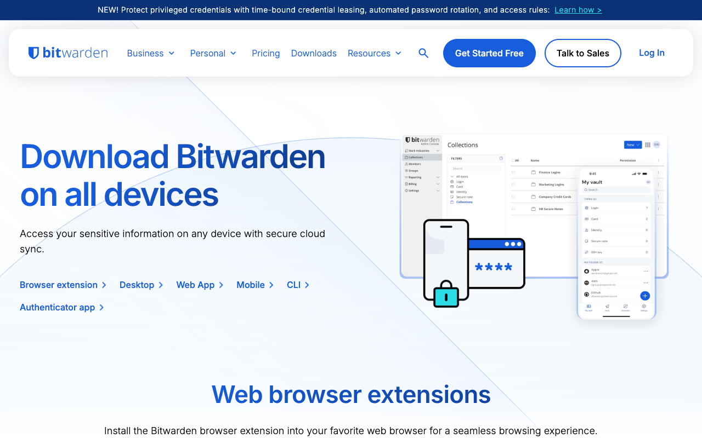

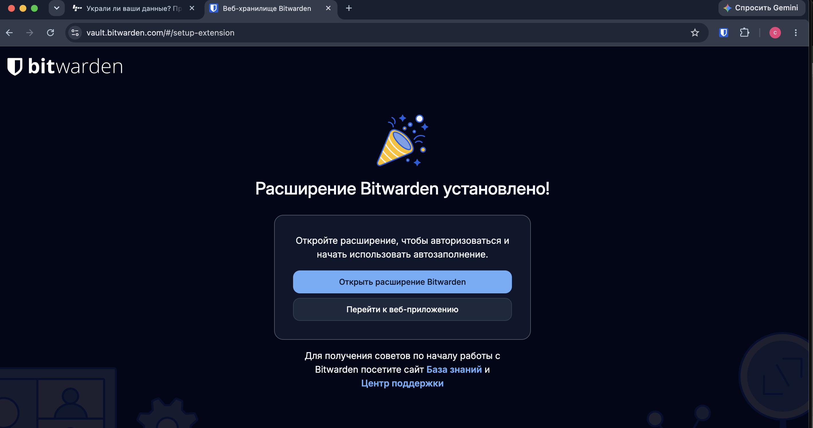

---

## 1. Создание учётной записи и мастер-пароля

Учётная запись создана на `vault.bitwarden.com` через «Create account».

Мастер-пароль длиной 20 символов, уникальный: нигде больше не используется
и не записывается в заметки, облако или на стикер. Для мастер-пароля
Bitwarden также предлагает тип Passphrase — фразу из случайных слов: при
словаре EFF из 7776 слов шесть слов дают 6 · log₂ 7776 ≈ 77,5 бита энтропии,
и такую фразу проще запомнить.

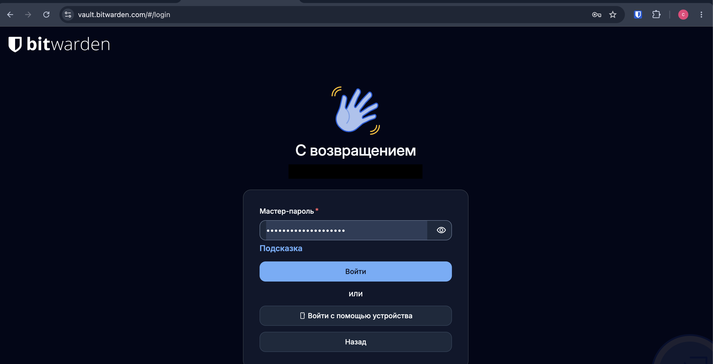

---

## 2. Аудит текущих паролей

### 2.1. Проверка email по базе утечек

Почта проверена на https://haveibeenpwned.com/. Вводился **только email**,
пароль не вводился (так требует задание). Дополнительно в веб-хранилище
Bitwarden построен отчёт **Отчёты → Отчёт об утечках данных** (Data breach
report). Он бесплатный и использует ту же базу HIBP: найдена та же утечка
1win (дата утечки — 2 ноября 2024 г., затронуто 96 166 543 пользователя).

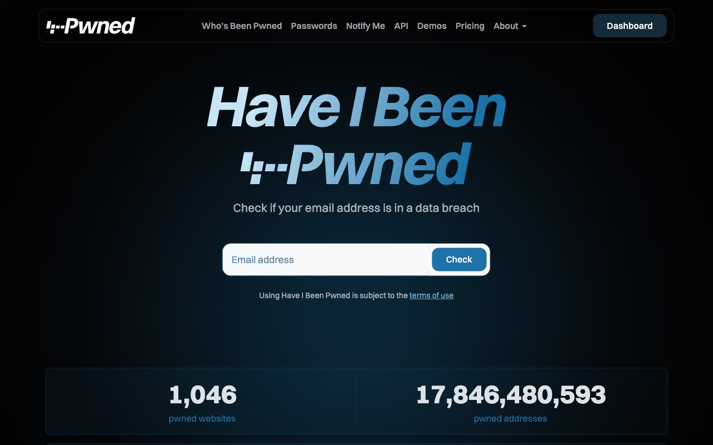

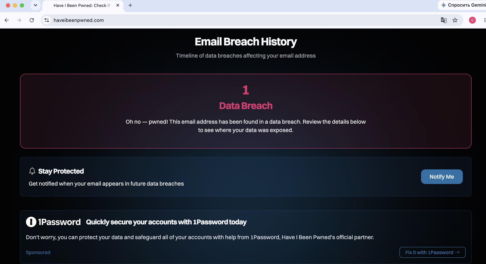

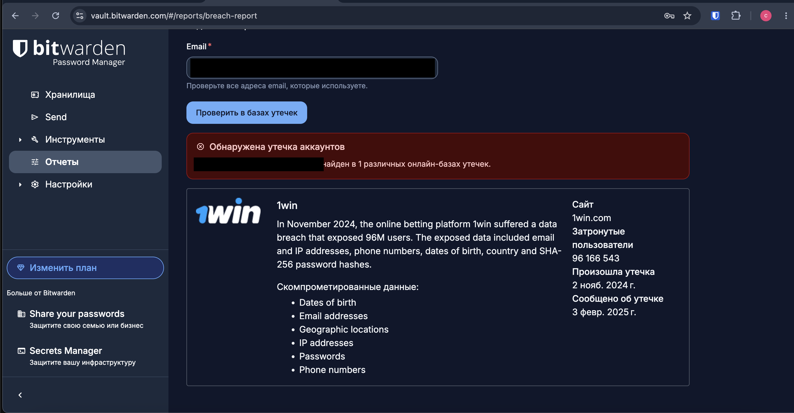

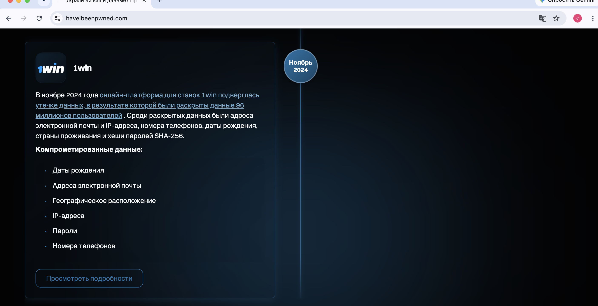

Результат: email найден в **1 утечке** — **1win** (онлайн-платформа ставок,
ноябрь 2024 года, раскрыты данные около 96 млн пользователей). Утекли адреса
электронной почты, IP-адреса, номера телефонов, даты рождения, страна
проживания и **хэши паролей SHA-256**. SHA-256 — быстрая хэш-функция, не
предназначенная для хранения паролей: на видеокарте она перебирается со
скоростью миллиардов вариантов в секунду, поэтому короткие и словарные пароли
из такой утечки восстанавливаются перебором. Значит, пароль от 1win нужно
считать скомпрометированным, а если он использовался на других сайтах,
под угрозой и те аккаунты.

### 2.2. Оценка слабости старых паролей

Сами пароли не приводятся, только их характеристики.

| Аккаунт | Длина | Состав символов | Повторялся на других сайтах | Проблема |
|---|---|---|---|---|
| AliExpress | короткий | имя + цифры | [TODO: да/нет] | короткий, начинается со словарного слова (имени) |
| Личный кабинет МГУ | короткий | имя + цифры | [TODO: да/нет] | короткий, начинается со словарного слова (имени) |
| Транспондер «Автодор» | короткий | имя + цифры | [TODO: да/нет] | короткий, начинается со словарного слова (имени) |
| GitHub | короткий | имя + цифры | [TODO: да/нет] | короткий, начинается со словарного слова (имени) |
| GitLab ИТМО | короткий | имя + цифры | [TODO: да/нет] | короткий, начинается со словарного слова (имени) |

**Какие пароли были слабыми.** Слабыми были все пять: короткие пароли
вида «имя + несколько цифр». Такие пароли подбираются не полным перебором,
а атакой по словарю с правилами: перебираются распространённые имена и слова,
к которым дописываются цифры, и подобный пароль находится за секунды или
минуты. Кроме того, почта найдена в утечке 1win, где пароли хранились
быстрым хэшем SHA-256, поэтому пароль, использованный на 1win, нужно считать
известным атакующим.

Почему такие пароли слабые, видно из оценки перебора. Пароль из 8 символов
(строчные буквы + цифры) — это 36⁸ ≈ 2,8 · 10¹² вариантов, около 41 бита.
Видеокарта перебирает быстрые хэши со скоростью порядка 10¹⁰ попыток в секунду,
то есть такой пароль подбирается за **минуты**. Пароль из словарного слова
с датой ломается ещё быстрее, по словарю с правилами, без полного перебора.

---

## 3. Замена паролей на 5 аккаунтах

### 3.1. Параметры генератора

Новые пароли созданы встроенным генератором Bitwarden (веб-хранилище:
**Инструменты → Генератор → Пароль**; тот же генератор вызывается кнопкой
у поля пароля при создании записи):

| Параметр | Значение |
|---|---|
| Тип | Password |
| Длина | 20 |
| A-Z | ✓ |
| a-z | ✓ |
| 0-9 | ✓ |
| `!@#$%^&*` | ✓ |

Алфавит: 26 + 26 + 10 + 8 = 70 символов. Энтропия пароля:
20 · log₂ 70 ≈ **122,6 бита**. Даже при 10¹² попыток в секунду полный перебор
займёт порядка 10¹⁷ лет. Требование задания (не менее 12 символов, буквы
разного регистра, цифры и спецсимволы) выполнено с запасом.

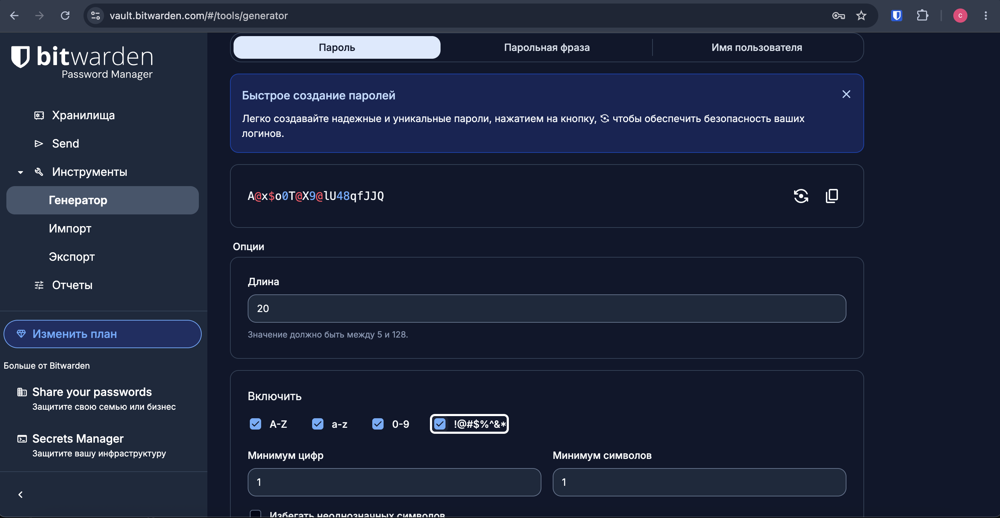

### 3.2. Процедура замены

Для каждого аккаунта:

1. В настройках аккаунта на сайте открыта форма «Сменить пароль».
2. В Bitwarden сгенерирован новый пароль и сохранён в запись хранилища
   (URL сайта + логин + пароль).
3. Новый пароль вставлен на сайте из Bitwarden, смена подтверждена.
4. Выполнен выход и повторный вход с автозаполнением из Bitwarden, чтобы
   убедиться, что сохранённый пароль правильный.

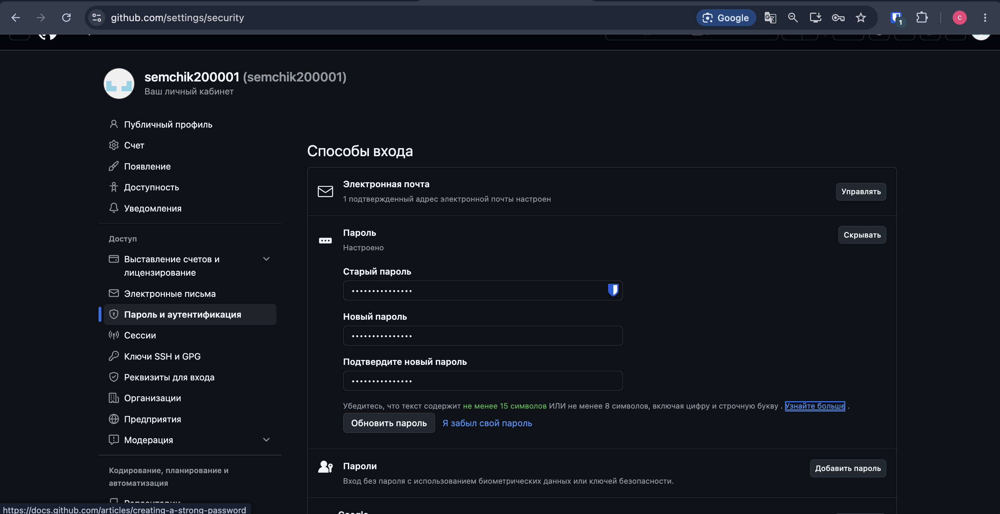

| # | Аккаунт | Новый пароль | Сохранён в Bitwarden |
|---|---|---|---|
| 1 | GitHub | 20 символов, A-Z a-z 0-9 спецсимволы | ✓ |
| 2 | GitLab ИТМО | 20 символов, A-Z a-z 0-9 спецсимволы | ✓ |
| 3 | Личный кабинет МГУ | 20 символов, A-Z a-z 0-9 спецсимволы | ✓ |
| 4 | AliExpress | 20 символов, A-Z a-z 0-9 спецсимволы | ✓ |
| 5 | Транспондер «Автодор» | 20 символов, A-Z a-z 0-9 спецсимволы | ✓ |

### 3.3. Главный интерфейс менеджера с созданной базой

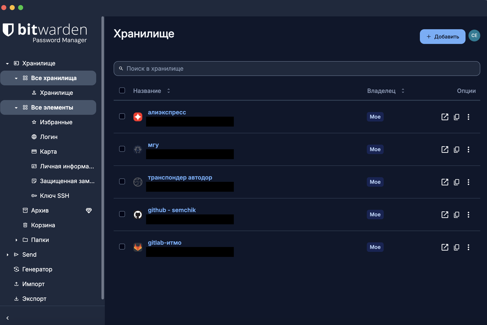

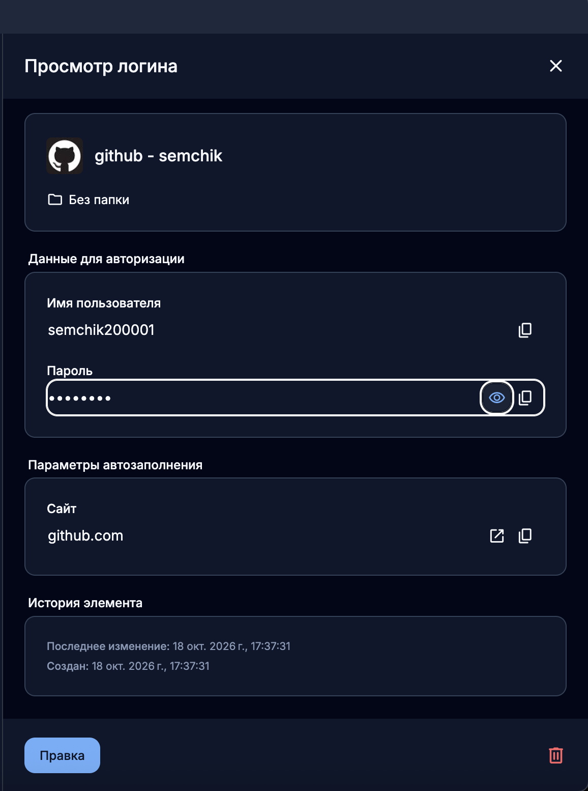

---

## 4. Двухфакторная аутентификация (TOTP) для GitHub

Настроено в GitHub: **Settings → Password and authentication →
Two-factor authentication → Authenticator app**.

1. GitHub показал QR-код с секретным ключом. Ключ закодирован в URI
   `otpauth://totp/...`.
2. QR-код отсканирован приложением Bitwarden Authenticator на телефоне.
   Приложение стало каждые 30 секунд выдавать 6-значный код.
3. Текущий код введён в GitHub для подтверждения.
4. Коды восстановления (recovery codes) скачаны и сохранены в Bitwarden как
   защищённая заметка (Secure note). Они нужны на случай потери телефона.
5. Проверка: выход из GitHub и повторный вход. После пароля GitHub запросил
   одноразовый код из приложения.

> Почему код на телефоне, а не внутри Bitwarden: на бесплатном тарифе
> Bitwarden может хранить ключ TOTP в записи, но генерация кодов в хранилище
> доступна только в Premium. Отдельное приложение на телефоне к тому же
> держит второй фактор на другом устройстве, отдельно от пароля.

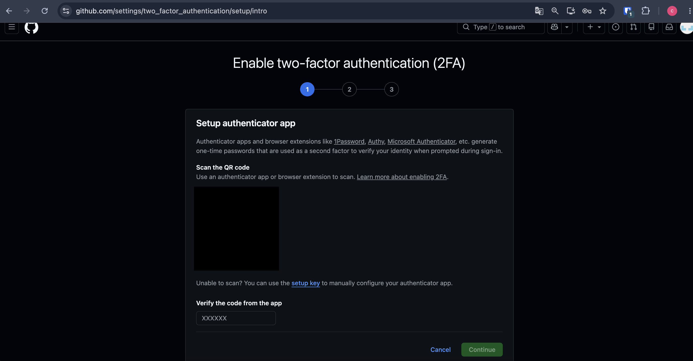


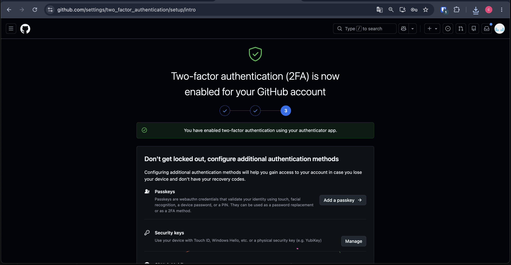

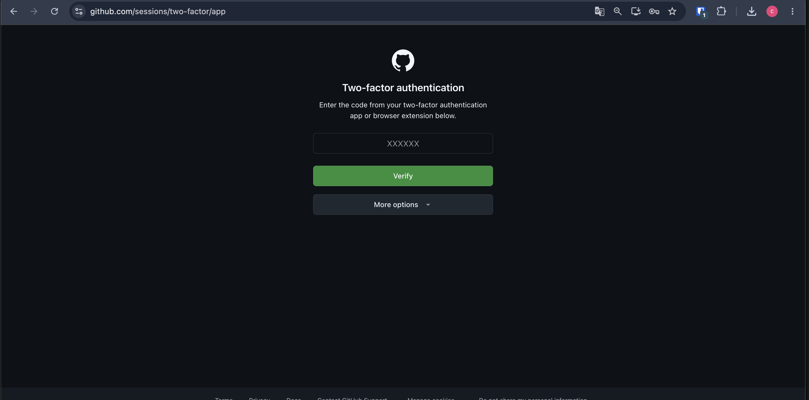

---

## 5. Что такое 2FA

**Двухфакторная аутентификация (2FA)** — это вход, при котором нужно
предъявить два фактора **разных типов**:

- то, что я **знаю**: пароль, PIN;
- то, что у меня **есть**: телефон с приложением-аутентификатором, аппаратный
  ключ (YubiKey);
- то, что я **есть**: отпечаток пальца, лицо.

**TOTP** (Time-based One-Time Password, RFC 6238) — самый распространённый
второй фактор. Сайт и приложение хранят общий секретный ключ. Каждые 30 секунд
обе стороны независимо вычисляют код:
`TOTP = Truncate(HMAC-SHA1(ключ, ⌊время / 30⌋)) mod 10⁶`. Код зависит от
времени, поэтому живёт недолго и повторно не используется. Сеть для расчёта
кода не нужна: приложение работает даже без интернета.

---

## 6. Контрольные вопросы

**1. Почему использование одного пароля на нескольких сайтах опасно?**

Сайты взламывают регулярно, и базы логинов и паролей попадают в открытый
доступ: в базе HIBP больше 17 млрд скомпрометированных аккаунтов. Атакующие
автоматически проверяют утёкшие пары «email + пароль» на других популярных
сервисах. Эта атака называется **credential stuffing**. Если пароль один и тот
же, утечка с самого слабого сайта (форума, игры, магазина) открывает доступ к
почте, а через восстановление пароля по почте — почти ко всему остальному.
Защищённость всех аккаунтов падает до уровня самого слабого сайта.

**2. Как двухфакторная аутентификация увеличивает безопасность аккаунта даже
при утечке пароля?**

Для входа нужен не только пароль, но и второй фактор, который нельзя получить
из утечки базы: одноразовый код с телефона пользователя. Атакующий с паролем
не войдёт без физического доступа к устройству. Код TOTP действует около 30
секунд, поэтому перехваченный старый код бесполезен. Пока атакующий упирается
во второй фактор, у владельца есть время узнать об утечке (например, через
HIBP) и сменить пароль.

**3. Почему мастер-пароль от менеджера должен быть особенно надёжным?**

Мастер-пароль — единственный ключ ко всем остальным паролям («все яйца в одной
корзине»). Из него выводится ключ шифрования хранилища (KDF: PBKDF2-SHA256 или
Argon2id). Если украдут зашифрованное хранилище (с сервера или с устройства),
его стойкость упирается только в стойкость мастер-пароля: его можно
перебирать офлайн без ограничения числа попыток. Пример — утечка хранилищ
LastPass в 2022 году. Кроме того, при zero-knowledge архитектуре Bitwarden не
может восстановить забытый мастер-пароль. Поэтому он должен быть длинным,
уникальным и запоминаемым, то есть парольной фразой. Сам аккаунт менеджера
тоже стоит защитить двухэтапным входом.

---

## 7. Выводы

- Установлен и настроен менеджер паролей Bitwarden, создана учётная запись
  с уникальным мастер-паролем из 20 символов.
- Проведён аудит: email проверен по базе утечек HIBP, оценена слабость старых
  паролей: все 5 старых паролей были короткими и строились по схеме
  «имя + цифры».
- Для 5 аккаунтов пароли заменены на случайные из 20 символов (~122,6 бита)
  и сохранены в Bitwarden. Теперь у каждого сайта свой пароль, и утечка
  одного из них не затронет остальные.
- Для GitHub настроена 2FA на TOTP, коды восстановления сохранены в
  Bitwarden.

## Источники

1. Bitwarden Help Center — Password generator: https://bitwarden.com/help/generator/
2. Bitwarden Help Center — Integrated authenticator: https://bitwarden.com/help/integrated-authenticator/
3. Bitwarden Help Center — Vault health reports: https://bitwarden.com/help/reports/
4. Have I Been Pwned: https://haveibeenpwned.com/
5. Kaspersky Daily — «Как придумать надёжный пароль»: https://www.kaspersky.ru/blog/perfect-password/
6. Cloudflare — «Что такое двухфакторная аутентификация»: https://blog.cloudflare.com/ru-ru/two-factor-authentication-2fa-ru-ru/
7. RFC 6238 — TOTP: Time-Based One-Time Password Algorithm: https://datatracker.ietf.org/doc/html/rfc6238
